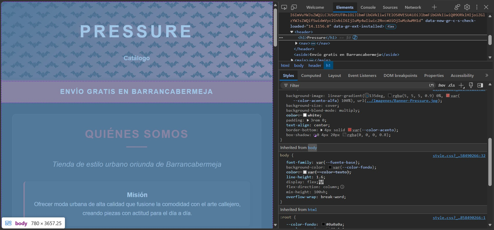
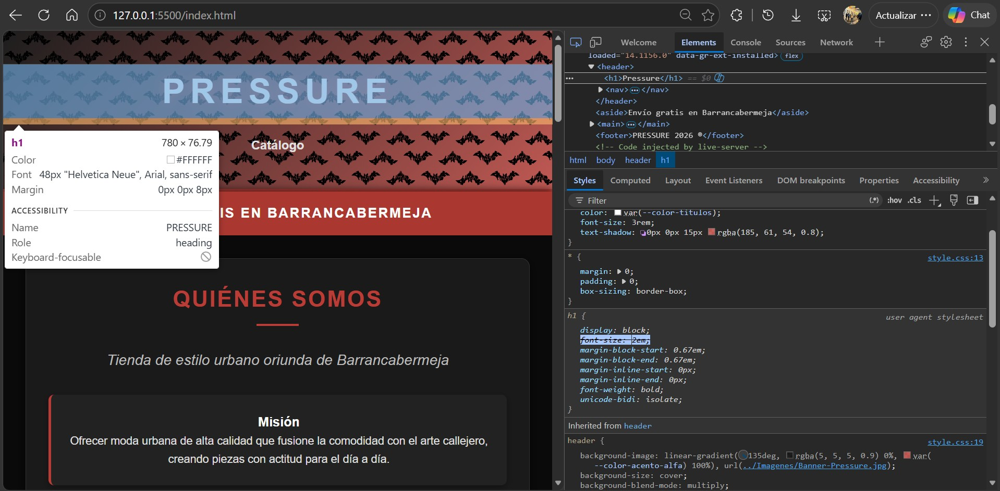
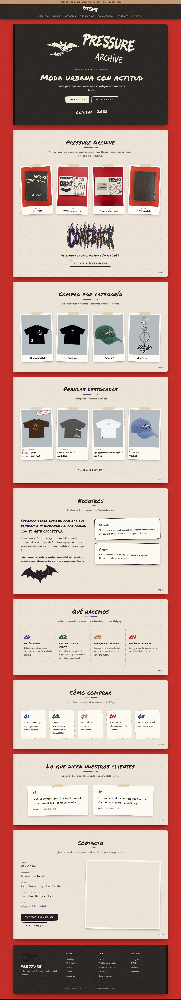
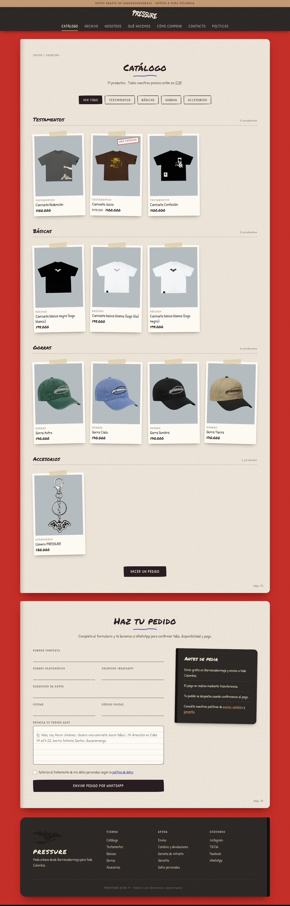
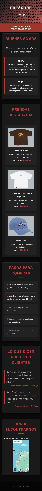
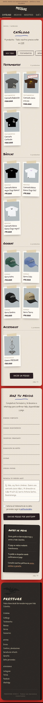

# 🛒 Pressure - Tienda de Ropa Urbana

## 1. El Proyecto
**Pressure** es un proyecto web creado para una tienda local de ropa urbana de estilo "streetwear" originaria de Barrancabermeja. El cliente necesitaba solucionar la pérdida de tiempo respondiendo catálogos por mensajes de texto; por lo tanto, el sitio web permite a los usuarios ver las colecciones de ropa, precios y estructurar un pedido que se envía automáticamente a su WhatsApp.

En la segunda versión el cliente pidió tomar como referencia visual la tienda de [Pull&Bear](https://www.pullandbear.com/co/hombre-n6228): cuadrícula de prendas por columnas, filtros por categoría y secciones informativas completas (nosotros, qué hacemos, contacto y políticas).

En la tercera versión (actual) el cliente envió las cuatro fotos del carrusel de Instagram de su campaña **Pressure Archive** (carpeta `imagenes de referencia/`): un cuaderno real de tapas negras, fotografiado sobre una mesa roja, con hojas crema dibujadas a lapicero y marcadores. Esas fotos son ahora la guía principal del estilo: el sitio se ve como un archivo artesanal, como si cada sección fuera una hoja de ese cuaderno.

## 2. Estructura
El proyecto se divide en tres páginas (`index.html`, `Catalogo.html` y `Politicas.html`) que comparten el mismo encabezado, menú y pie de página. Se implementó HTML semántico para estructurar el contenido:
* `<aside>`: Barra de anuncio en la parte superior (envío gratis en Barrancabermeja y envíos a toda Colombia).
* `<header>` y `<nav>`: Encabezado fijo (`position: sticky`) con el logo y el menú principal. El enlace de la página actual se marca con `aria-current="page"`.
* `<main>`: Contenedor principal. En `index.html` contiene, en orden: portada, Pressure Archive (la campaña), Compra por categoría, Prendas destacadas, Nosotros, Qué hacemos, Cómo comprar, Testimonios y Contacto.
* `<section>`: Separación de bloques temáticos. Cada sección tiene un `id` para navegar con anclas desde el menú (`index.html#nosotros`, `#contacto`, etc.).
* `<article>`: Utilizado con clases bajo la metodología BEM (`.tarjeta-prenda`, `.tarjeta-prenda__marco`, `.tarjeta-prenda__titulo`, ...) para agrupar cada producto individual, y también para cada política.
* `<figure>`, `<blockquote>` y `<figcaption>`: Testimonios de clientes y fotos de la campaña (cada foto con su pie numerado: Nº 01, Nº 02...).
* `<dl>`: Datos de contacto (WhatsApp, ubicación, horario, redes).
* `<footer>`: Pie de página en columnas con enlaces a la tienda, a las políticas y a las redes.

**Páginas:**
* `index.html`: Página de inicio con todas las secciones informativas.
* `Catalogo.html`: Cuadrícula de productos agrupada por colección (Testamentos, Básicas, Gorras, Accesorios), con filtros por categoría y el formulario de pedido.
* `Politicas.html`: Envíos, cambios y devoluciones, derecho de retracto, garantía, medios de pago, tratamiento de datos personales y PQR, con una nota de resumen al inicio.

## 3. Sistema Visual
La estética sale directamente de las fotos del cuaderno **Pressure Archive**. Los colores se tomaron con un cuentagotas sobre las fotos:

| Variable | Color | De dónde sale |
|---|---|---|
| `--color-mesa` | `#c8322b` | Rojo de la mesa. Es el fondo de toda la página. |
| `--color-portada` | `#1f1b19` | Negro de las tapas. Encabezado, portada, pie de página y la libreta "Antes de pedir". |
| `--color-hoja` | `#f1ebdf` | Crema de las hojas. Fondo de cada sección. |
| `--color-tinta` | `#2a1d22` | Tinta del lapicero de los dibujos. Títulos y botones (`--color-acento`). |
| `--color-azul` | `#3a4aa0` | Marcador azul de "PRESSURE STAKES". Subrayados, enlaces y números. |
| `--color-verde` | `#2f5a3f` | Marcador verde. |
| `--color-kraft` | `#c49a73` | Marcador color piel / kraft. Barra de anuncio y detalles. |
| `--color-tiza` | `#efe9d6` | Pintura crema de la portada. Textos sobre las tapas negras. |

* **El cuaderno:** cada `<section>` de `<main>` es una hoja crema con esquinas redondeadas y sombra sobre la mesa roja. Una sombra interna a la izquierda imita el pliegue de la costura y cada hoja lleva su número de página escrito a máquina. La portada (`.hero`) es la tapa negra con lomo cosido y el pie de página es la contraportada con el murciélago en relieve.
* **Recursos tomados de las fotos:** el lettering "PRESSURE" y "ARCHIVE" pintado en la tapa, el murciélago de la marca, el murciélago a lapicero y el "COMEBACK" con llamas se recortaron de las fotos y se guardaron como PNG con fondo transparente en `Imagenes/Archivo/`. Así el logo del encabezado es la letra real del cliente, no una fuente que la imite.
* **Texturas:** el grano del papel, de las tapas y de la mesa se genera con un filtro SVG (`feTurbulence`) guardado en variables (`--textura-papel`, `--textura-portada`, `--textura-mesa`), sin imágenes extra.
* **Fuentes (Google Fonts):** `Permanent Marker` para títulos (marcador), `Patrick Hand` para el texto (letra a mano legible) y `Special Elite` para etiquetas y datos (máquina de escribir, el toque de "archivo").
* **Fotos pegadas:** las prendas, categorías, fotos de la campaña y testimonios se ven como fotos pegadas con cinta de enmascarar (`::before` con `clip-path` para los bordes rasgados) y ligeramente giradas con una variable `--giro`. Al pasar el mouse se enderezan.
* **Botones y fichas:** bordes irregulares hechos con `border-radius` elíptico (`--borde-mano`), como un recuadro dibujado a mano. La etiqueta "Más vendida" es un sello de tinta roja.
* **Números:** los de "Qué hacemos" y "Cómo comprar" van rellenos de marcador con contorno de tinta (`-webkit-text-stroke` + `paint-order`), igual que el lettering "PRESSURE STAKES 2026".
* **Gris de producto:** `--color-producto: #b4bcbf` es el gris del fondo de las fotos de producto y se usa en el marco de cada imagen para que todas se vean uniformes.
* **Mapa:** el `iframe` de Google Maps usa `filter: grayscale(1) sepia(0.4)` para verse como una foto vieja pegada en la hoja.

## 4. Especificidad (Resolución de Conflictos)
A continuación, se documentan tres conflictos reales de la hoja `style.css` resueltos mediante especificidad y orden:

### Conflicto 1: Margen inferior del Título H1
* `*` -> Especificidad (0,0,0) -> `margin: 0;`
* `header h1` -> Especificidad (0,0,2) -> `margin-bottom: 0.5rem;`
**Resultado:** Gana `header h1` por contar con dos etiquetas en su selector frente al selector universal. El navegador aplica el `0.5rem` y tacha el `0` universal.

### Conflicto 2: Color de los subtítulos H2
* `h2` -> Especificidad (0,0,1) -> `color: #888888;`
* `section h2` -> Especificidad (0,0,2) -> `color: var(--color-acento);`
**Resultado:** Gana `section h2` al poseer mayor peso (dos etiquetas), aplicando el color de acento (tinta `#2a1d22`) y tachando la regla gris del `h2` general.

### Conflicto 3: Resolución por Orden en Cascada
Reglas que compiten sobre el mismo `<article>`:
* `.tarjeta-prenda` -> Especificidad (0,1,0) -> `background-color: #555555;`
* `.tarjeta-prenda` -> Especificidad (0,1,0) -> `background-color: #fdfaf3;`
**Resultado:** Al haber un empate exacto en especificidad (una clase), gana la regla de `#fdfaf3` (el papel de las fotos pegadas) por orden de cascada, porque fue declarada última en el archivo `style.css`.

*(Nota: las capturas de los conflictos 2 y 3 corresponden a la primera versión del sitio; los selectores son los mismos, pero los valores de color cambiaron con los rediseños.)*

## 5. Herencia
* **Propiedad heredada:** `font-family` y `color` (definidas en el `body`, se heredan automáticamente a elementos hijos como `
`, `<li>`, sin declararlas de nuevo).
* **Propiedad NO heredada:** `padding` o `border`. El padding de las `<section>` no afecta a las etiquetas `<article>` hijas; estas requieren su propia declaración explícita (por ejemplo, `.bloque { padding: 2rem; }`).
* **Variables heredadas:** `--giro` se define en cada tarjeta según su posición (`:nth-child(4n + 1)`, etc.) y la regla general `transform: rotate(var(--giro, 0deg))` la usa. Las custom properties sí se heredan.

## 6. Modelo de Cajas
Cálculo del ancho de las fichas de Misión y Visión (`.bloque`) en una pantalla de escritorio de 1440px:
* Ancho de la hoja (`main > section`): `min(100% - 2.5rem, 1240px)` = **1240px**.
* `padding` lateral de la hoja: 4rem + 4rem = 128px. Espacio útil: 1240 - 128 = **1112px**.
* La rejilla `.nosotros` tiene columnas `1fr 1fr` y un `gap` de 4rem (64px): (1112 - 64) / 2 = **524px** por columna. La ficha ocupa la segunda columna.
* `padding` de la ficha: 2rem (32px a la izquierda + 32px a la derecha = 64px).
* `border`: 2px (2px izquierda + 2px derecha = 4px).
**Ancho disponible para el texto:** 524 - 64 - 4 = **456px**.
*(Nota: gracias al uso global de `box-sizing: border-box`, el padding y el borde se restan hacia el interior: la hoja mide exactamente 1240px y la ficha sus 524px de columna, sin desbordarse).*

## 7. Selectores
* **`:nth-of-type()`:** `main > section:nth-of-type(even)` selecciona las secciones pares que son hijas directas de `<main>` y les pone un fondo de hoja punteada (un `radial-gradient` repetido). Así se alternan hojas lisas y punteadas, como en un cuaderno de bocetos, sin agregar clases a cada sección.
* **`:not()`:** `main > section:not(.hero)` cuenta las hojas y escribe su número de página, dejando por fuera la portada.
* **`:target` + `:has()` (filtro sin JavaScript):** Cada botón de categoría del catálogo es un ancla (`href="#gorras"`). Al hacer clic, esa categoría se vuelve `:target` y la regla `.catalogo:has(.categoria:target) .categoria:not(:target) { display: none; }` oculta las demás. "Ver todo" apunta a `#catalogo`, que no es una categoría, y por eso se muestran todas.
* **Selectores de atributo:** `.catalogo:has(#gorras:target) .filtro[href="#gorras"]` resalta en negro el filtro activo, y `header nav a[aria-current="page"]` subraya la página actual en el menú.
* **Contadores CSS:** Los pasos de "Cómo comprar" se numeran con `counter-reset`, `counter-increment` y `content: counter(paso, decimal-leading-zero)`, que genera 01, 02, 03... El mismo recurso numera las hojas (`pág. 01`, `pág. 02`...) con el contador `pagina`.

## 8. Responsive (@media)
El diseño se adapta con cuatro puntos de quiebre:
* **`max-width: 1024px`:** La cuadrícula de productos pasa de 4 a 3 columnas, las fotos de la campaña y "Qué hacemos" de 4 a 2 y el pie de página de 4 a 2 columnas.
* **`max-width: 900px`:** Las hojas reducen su padding. Nosotros, Contacto, el formulario de pedido y las políticas pasan a una sola columna. El mapa toma una proporción 4:3.
* **`max-width: 768px`:** Las hojas casi tocan los bordes de la pantalla (`--ancho-hoja` cambia a `100% - 1.25rem`) y en la portada el murciélago queda encima del lettering. La cuadrícula de productos y las categorías quedan en 2 columnas (como en las tiendas de moda en móvil). El menú y los filtros del catálogo se convierten en una fila deslizable horizontalmente. Los testimonios quedan en una columna.
* **`max-width: 600px`:** "Qué hacemos", el formulario y el pie de página quedan en una sola columna, y los botones ocupan todo el ancho.
* **`prefers-reduced-motion`:** Se desactivan las transiciones y el desplazamiento suave para quienes lo prefieran desde su sistema operativo.

## 9. Problemas y Soluciones
1. **Envío de Formulario HTML:** Al probar el formulario con `method="POST"`, el Live Server arrojaba error por falta de backend. **Solución:** Se ajustó a `method="get"`, apuntando el `action` directamente a la API de `wa.me`, y mapeando el `<textarea>` con `name="text"` para prellenar el mensaje en WhatsApp solo con HTML.
2. **Textos invisibles:** En la primera versión, al aplicar el fondo rojo a toda la caja `<section>`, los títulos `<h2>` (que también eran rojos) se volvían invisibles por falta de contraste. **Solución:** Se separó el color de fondo de las secciones del color de acento, que se usa solo en títulos, bordes y el pseudo-elemento `::after`.
3. **Selectores por posición que afectaban otras páginas:** Las reglas `main section:nth-of-type(2)` y `:first-of-type` del inicio también se aplicaban a secciones anidadas del catálogo, y el formulario quedaba angosto y centrado. **Solución:** Se reemplazaron por clases BEM (`.grilla-productos`, `.nosotros`, `.pedido`) y se usó el combinador hijo `>` en el único `:nth-of-type` que quedó.
4. **Fotos de distintas proporciones:** Las gorras y el llavero no medían lo mismo que las camisetas y las tarjetas quedaban desalineadas. **Solución:** Un marco con `aspect-ratio: 4 / 5`, `object-fit: contain` y el mismo gris de fondo de las fotos.
5. **Encabezado fijo tapando las secciones:** Al navegar con anclas, el header `sticky` cubría el título de la sección. **Solución:** `scroll-padding-top` en el elemento `html`.
6. **Usar los dibujos del cliente sin el fondo de la foto:** Los recortes del lettering y de los murciélagos traían el negro de la tapa o el crema de la hoja y se veían como un rectángulo. **Solución:** Se convirtieron a PNG con transparencia calculando la opacidad de cada píxel según su brillo (claro sobre oscuro para la tapa, oscuro sobre claro para la hoja) y se limpiaron restos de otras letras.
7. **Números invisibles:** El número 04 de "Qué hacemos" y "Cómo comprar" iba en crema y casi no se veía sobre la hoja crema. **Solución:** Ese número usa el rojo de la mesa (`--color-mesa`), que sigue dentro de la paleta.
8. **Fuentes manuscritas pequeñas:** `Patrick Hand` se lee más pequeña que una sans-serif al mismo tamaño. **Solución:** El tamaño base del `body` subió a `1.125rem` y los textos largos (políticas, testimonios) van entre `1.15rem` y `1.35rem`.

## 10. Capturas del Proyecto
A continuación, el diseño renderizado del sitio en diferentes resoluciones:

### Escritorio (Desktop)
* **Página de Inicio:**

* **Página de Catálogo:**

### Móvil (390px)
* **Página de Inicio (Mobile):**

* **Página de Catálogo (Mobile):**

